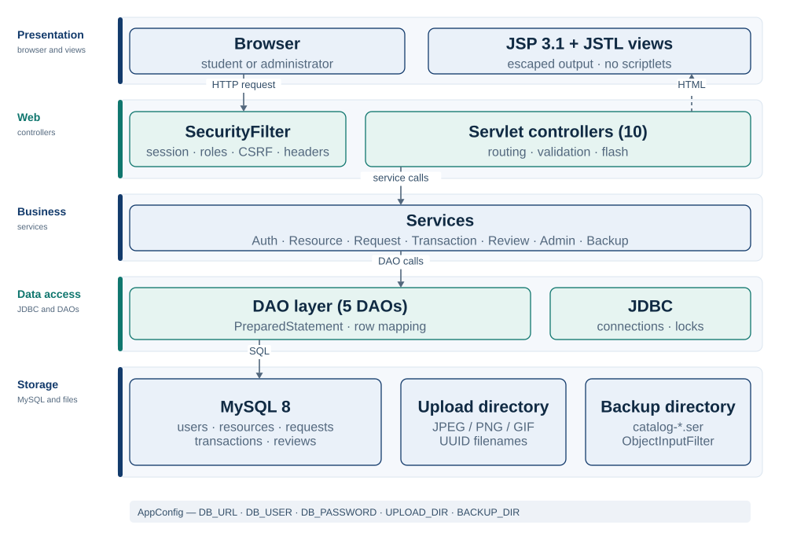
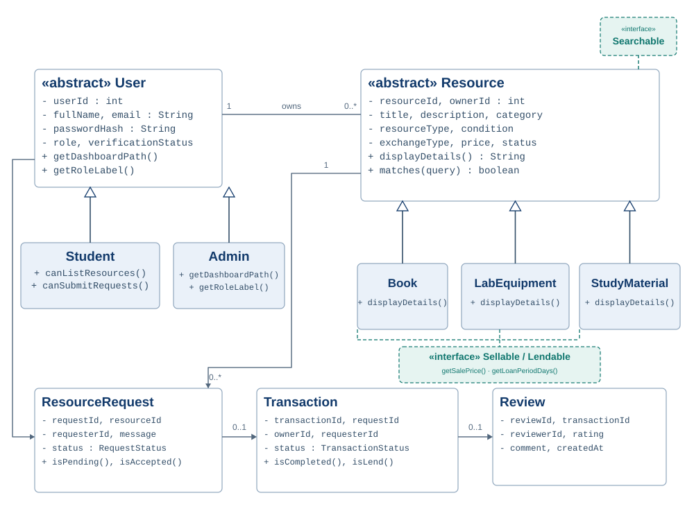
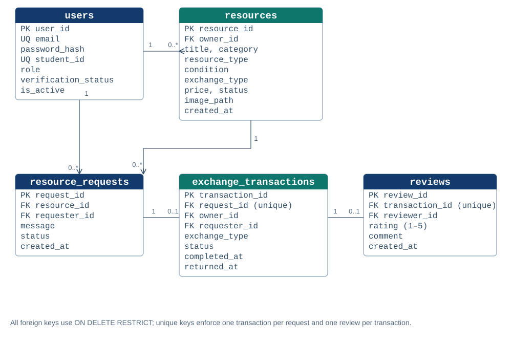
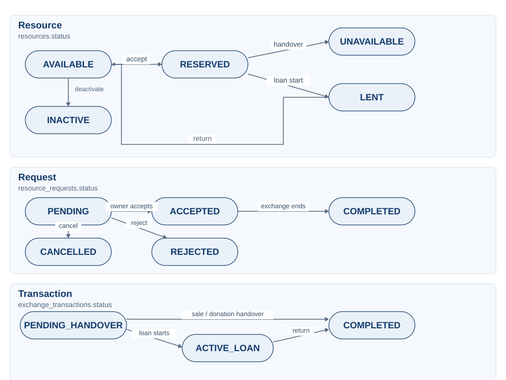
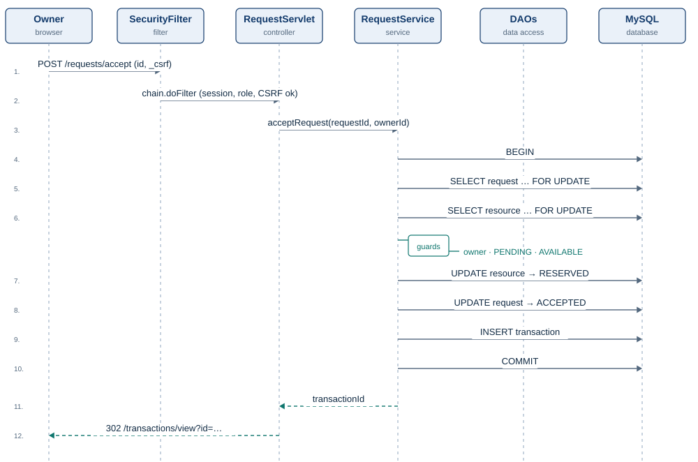

## Abstract

Students routinely accumulate textbooks, laboratory equipment, calculators, and course notes that become idle once a course ends, while other students on the same campus need those exact resources and find them expensive or difficult to obtain. Existing channels for redistributing such material — messaging groups, notice boards, and general classified advertisements — provide no identity verification, no structured record of an exchange, and no accountability once a transaction is agreed. This report describes the design, implementation, and evaluation of **Campus Resource Exchange**, a database-backed web application that supports the complete lifecycle of a peer-to-peer academic exchange: registration and administrator verification, listing and discovery, requesting, owner decisions, handover or loan tracking, and post-completion reviews.

The system is deliberately constructed on a conventional Jakarta EE foundation — Jakarta Servlet 6.0, Jakarta Server Pages 3.1, JSTL 3.0, plain JDBC, and MySQL 8 — without Spring, JPA, an object-relational mapper, or a JavaScript framework. The architecture separates presentation, web control, business rules, and data access, with services owning transaction boundaries and a central filter enforcing authentication, role checks, and cross-site request forgery (CSRF) protection. Two design problems received particular attention: consistent reservation of a resource when several requests are accepted concurrently, solved with row-level locking and conditional updates inside a single database transaction; and safe deserialisation of administrator-created catalogue backups, solved with a strict `ObjectInputFilter` allowlist and validation before any insert.

Evaluation combined 53 unit tests (JUnit 5 and Mockito), a 23-step end-to-end HTTP smoke suite, compilation of all 22 JSP templates, and a manual acceptance walkthrough. All 53 unit tests pass with no failures or errors; the WAR builds and deploys; and the smoke suite passes all 23 steps, including a run after restarting the application server. The final revision adds four capabilities that earlier drafts treated as future work — a fourth resource type (*daily essentials*), mandatory lending fees, catalogue sorting, and pagination — together with a JDBC connection pool, per-account login throttling, a same-site session cookie, and a CI pipeline that runs both the unit suite and the smoke suite. The report also records the defects found during verification — the deserialisation filter initially rejected primitive arrays, which silently broke every restore containing a price, and the restore path later re-applied new business rules to old backups — and discusses the residual security and scalability limitations of the version-1.1 design.

**Keywords:** Jakarta EE; servlet; JSP; JDBC; MySQL; layered architecture; peer-to-peer exchange; CSRF; deserialisation filter; software testing.

<!-- TOC -->

## 1. Introduction

### 1.1 Context and motivation

The cost of participating in higher education extends well beyond tuition. Textbooks, laboratory kits, drawing instruments, calculators, and printed course notes are purchased for a single semester and often retain little value for the student who bought them, yet substantial value for the student who takes the same course next. At the same time, the sustainability argument for reuse is straightforward: every second-hand textbook that changes hands displaces a new copy, and every loaned piece of equipment keeps an infrequently used object in circulation rather than in storage.

The wider phenomenon is usually described as *collaborative consumption* or the *sharing economy*: the organisation of access to underused goods through community-based platforms rather than through individual ownership [1]. Empirical work on participation in such systems identifies economic benefit, sustainability, and community as the main motivations [2]. A campus is an unusually favourable setting for these mechanisms because its participants are co-located, share a common institutional identity, and can complete an exchange face to face. Those same properties make a campus-specific platform more plausible than a general classified site: a student ID, a department, a course code, and a pickup location are meaningful attributes that generic marketplaces do not model.

### 1.2 Problem statement

Despite this favourable setting, the practical infrastructure is weak. Exchanges are arranged in informal messaging groups, on departmental notice boards, or through word of mouth. These channels have four recurring weaknesses:

1. **Identity is unverified.** A buyer or borrower cannot tell whether a counterpart is a current student, an alumnus, or an outsider.
2. **Discovery is poor.** Posts are chronological and unstructured; there is no reliable way to filter by course code, condition, exchange type, or price.
3. **The exchange has no state.** Once a seller and a buyer agree informally, nothing records whether the item was reserved, handed over, returned, or reviewed. Two students can believe they have reserved the same book.
4. **There is no accountability.** A student who repeatedly fails to return a loan leaves no trace that future counterparties can inspect.

The problem addressed here is therefore not merely "build a marketplace". It is to provide a *campus-scoped, verified, stateful exchange* in which the rules that prevent double reservation, unauthorised modification, and duplicate reviews are enforced by the application rather than by goodwill.

### 1.3 Objectives

The project pursued six objectives:

- **O1 — Architecture.** Design a maintainable layered web application using only the prescribed stack: Java 17 bytecode, Jakarta Servlet 6.0, JSP 3.1, JSTL 3.0, JDBC, MySQL 8, and Apache Tomcat 10.1.
- **O2 — Lifecycle.** Implement the complete exchange lifecycle for four resource types (books, laboratory equipment, study material, and daily essentials) and three exchange types (sale, loan, and donation), including request decisions, handover, loan return, and reviews.
- **O3 — Security.** Enforce authentication, role-based authorisation, ownership checks, CSRF protection, secure file upload, output escaping, and safe error handling at the server.
- **O4 — Object-oriented design.** Demonstrate abstraction, inheritance, polymorphism, interfaces, encapsulation, exception handling, collections, file handling, and serialisation in working code rather than in isolated examples.
- **O5 — Verification.** Unit-test the business rules without a live database, exercise the deployed application end to end over HTTP, and check the result against explicit acceptance criteria.
- **O6 — Documentation.** Provide reproducible instructions for database creation, configuration, build, deployment, demonstration, and backup.

### 1.4 Contributions

The work makes five concrete contributions:

1. A **layered reference implementation** of a campus exchange in which the dependency direction is strictly presentation → web → service → data access, with no SQL in servlets and no HTML in DAOs.
2. A **transactional request-acceptance protocol** that combines `SELECT … FOR UPDATE`, conditional status updates, and a single commit to make double reservation impossible under concurrent owners or requests.
3. A **defence-in-depth security design** in which the central filter and the service layer independently enforce authorisation, so that a routing mistake does not silently become an access-control bypass.
4. A **restricted serialisation backup** whose deserialisation path is guarded by a class allowlist, resource limits, filename validation, and item-level validation before the first database insert.
5. **Empirical verification** of the implementation through 53 unit tests, a 23-step end-to-end suite, and a documented acceptance checklist, including the discovery and repair of a real deserialisation defect and of a restore path that rejected older backups after a business-rule change.

### 1.5 Scope and delimitations

The system is a single-campus, single-instance application. Students arrange payment and pickup themselves; the application records and tracks the exchange but never processes money. Student verification is performed manually by an administrator rather than through a university identity service. The following are explicitly out of scope for version 1: online payments, real-time chat, push or email notifications, delivery logistics, recommendation algorithms, overdue reminders, password reset, email verification, and automated browser tests. These exclusions are deliberate: they keep the project within a semester-sized effort and keep the assessed technologies — servlets, JSP, JDBC, JDBC transactions, file handling, and Java serialisation — at the centre of the implementation.

### 1.6 Organisation of the report

Section 2 situates the project in the literature and in established architectural practice. Section 3 derives functional and non-functional requirements. Section 4 presents the architecture, domain model, database schema, state model, concurrency protocol, and threat model. Section 5 describes the implementation, including the security-sensitive upload and backup paths. Section 6 reports the testing strategy and results. Section 7 discusses trade-offs, residual risks, and limitations. Section 8 concludes and identifies future work.

## 2. Background and related work

### 2.1 Collaborative consumption on campus

Collaborative consumption describes systems in which goods are shared, swapped, lent, or resold rather than owned exclusively [1]. Studies of sharing platforms consistently find that participants are motivated by a mixture of price, convenience, sustainability, and social connection, and that trust between strangers is the central design problem [2]. Campus exchange sits at the favourable end of this space: participants are physically close, exchanges are low-value, and institutional affiliation supplies a weak but real basis for trust. The design implication is that the platform should *amplify* that trust with verification and a visible history, rather than attempt to replace it with escrow or payment infrastructure.

### 2.2 Existing channels and their limitations

Table 2.1 compares the channels a student might use today with the proposed system. The comparison is qualitative; it is intended to justify requirements, not to report a user study.

<p class="table-caption" id="tab2-1">Table 2.1. Comparison of channels for redistributing academic resources.</p>

| Channel | Identity | Structured search | Exchange state | Accountability |
|---|---|---|---|---|
| Messaging groups | Weak; display name only | None | Informal chat only | None |
| Departmental notice board | None | None | None | None |
| Library reserve | Institutional | Catalogue only | Loan record | Fines, but no peer review |
| General classified site | Email/phone only | Good | Weak | Ratings, not campus-specific |
| **Campus Resource Exchange** | **Administrator-verified student ID** | **Course, type, condition, price** | **Request, transaction, loan, return** | **Reviews tied to completed transactions** |

The table makes the gap explicit. General marketplaces solve discovery but not campus identity or the academic attributes that matter (course code, department, pickup point). Messaging groups solve familiarity but not state. The proposed system combines verified campus identity, academic metadata, and an explicit exchange lifecycle.

### 2.3 Architectural background

The implementation follows the Model–View–Controller interpretation known as *Model 2* for Java web applications: servlets act as controllers, JSP templates render views, and domain objects plus services form the model. This separation is an application of the broader layered architectural pattern, in which each layer depends only on the layer beneath it and knowledge of the database is confined to the data-access layer [4]. The data-access object (DAO) pattern isolates SQL and JDBC mapping behind an interface-like class boundary, so that business rules operate on domain objects rather than on `ResultSet` rows [4].

The design also uses several patterns catalogued by Gamma *et al.* [3]: the **Template Method** in the abstract `BaseServlet`, which fixes the request-handling skeleton and leaves routing to subclasses; the **Factory Method** in `ResourceService.newResource`, which returns the correct `Resource` subclass for a type; the **Strategy**-like use of the `Searchable` interface for catalogue matching; and the **Data Transfer Object** in the serialisable backup classes, which decouple the persisted representation from the live domain model.

### 2.4 Security background

Web application security was treated as a design constraint rather than an afterthought. The OWASP Top 10 identifies broken access control, injection, insecure design, security misconfiguration, and software and data integrity failures as the most consequential risk categories [15]. Each maps directly onto a decision in this project: authorisation is checked twice (filter and service); every SQL statement is parameterised; secrets are supplied through the environment; and serialised data is treated as untrusted even when an administrator uploaded it.

Three specific mechanisms deserve mention. Password storage uses BCrypt, a deliberately slow, salted hash designed to resist offline guessing [5]. CSRF defence uses the synchroniser-token pattern recommended by OWASP [6]: a random token bound to the session is required on every state-changing request. File upload follows the OWASP guidance to validate content rather than trust the filename, generate server-side names, store files outside the web root, and serve them through a controlled handler [7]. Java deserialisation is a well-known remote-code-execution vector when untrusted streams are accepted; the mitigation used here is a JVM `ObjectInputFilter` allowlist plus validation, following OWASP's deserialisation guidance [8].

### 2.5 Position of this work

The project does not claim to advance sharing-economy theory or to outperform commercial marketplaces. Its contribution is an *engineering* one: a complete, auditable, framework-free implementation of a stateful campus exchange, with explicit attention to concurrency, authorisation, and deserialisation safety, verified against a stated acceptance list. That makes it useful both as a teaching artefact for Jakarta EE and as a worked example of how far a small set of well-understood patterns can carry a realistic application.

## 3. Requirements analysis

### 3.1 Stakeholders and roles

The system recognises two authenticated roles and one unauthenticated visitor (Table 3.1). The visitor may browse the catalogue but may not list, request, or review. A student account begins in the `PENDING` verification state and must be verified by an administrator before it can create listings or submit requests. An administrator can verify or reject students, suspend accounts, moderate listings, inspect activity, and create or restore catalogue backups.

<p class="table-caption" id="tab3-1">Table 3.1. Stakeholders and responsibilities.</p>

| Stakeholder | Authentication | Principal capabilities |
|---|---|---|
| Visitor | None | Browse and search available listings; view listing details |
| Student (pending) | Email + password | Edit profile; browse; cannot list or request until verified |
| Student (verified) | Email + password | List, edit, deactivate; request; accept or reject incoming requests; track exchanges; review completed exchanges |
| Administrator | Email + password | Verify or reject students; suspend or reactivate accounts; moderate listings; view requests, transactions, and reviews; create and restore backups |

### 3.2 Functional requirements

Table 3.2 summarises the functional requirements. Priorities use the MoSCoW convention: **M** (must), **S** (should), and **C** (could). All must-have requirements were implemented; the should-have and could-have items are identified so that the scope boundary is explicit.

<p class="table-caption" id="tab3-2">Table 3.2. Functional requirements.</p>

| ID | Requirement | Priority |
|---|---|---|
| FR-01 | A visitor can register with name, email, student ID, password, department, and year of study. | M |
| FR-02 | A registered user can log in, log out, and edit their profile. | M |
| FR-03 | An administrator can verify or reject a pending student and suspend or reactivate an account. | M |
| FR-04 | A verified student can create, edit, and deactivate a listing with title, description, category (chosen from existing categories or created inline), type, condition, exchange type, a price or lending fee, loan terms, course code, pickup location, and an optional image. | M |
| FR-05 | Any visitor can browse and search available listings by keyword, category, course code, pickup location, type, condition, exchange type, and price range, and sort the result by price or condition. | M |
| FR-06 | A verified student can request an available listing with an optional message. | M |
| FR-07 | The owner can accept or reject a pending request; the requester can cancel one. | M |
| FR-08 | Accepting a request creates exactly one transaction and reserves the resource atomically. | M |
| FR-09 | A sale or donation can be completed at handover; a loan can be started and later returned. | M |
| FR-10 | The requester can submit one review with a rating of 1–5 after a transaction is completed. | M |
| FR-11 | An administrator can view summary statistics, users, listings, requests, transactions, and reviews. | M |
| FR-12 | An administrator can create a serialised catalogue backup and restore it additively. | M |
| FR-13 | The catalogue and dashboards show useful empty states and flash messages for every action. | S |
| FR-14 | The interface adapts to mobile and desktop widths and uses accessible labels and contrast. | S |
| FR-15 | The catalogue is paginated so that page size stays bounded as the number of listings grows. | S |
| FR-16 | A lending listing must carry a positive lending fee; a sale must carry a positive price; a donation is free. | M |

### 3.3 Non-functional requirements

Table 3.3 states the non-functional requirements and, importantly, how each was to be verified. Requirements without a verification method tend to become aspirations; tying each to a test or an inspection kept the evaluation honest.

<p class="table-caption" id="tab3-3">Table 3.3. Non-functional requirements and verification.</p>

| ID | Requirement | Verification |
|---|---|---|
| NFR-01 | **Security:** no plaintext passwords; no SQL string concatenation; no unescaped user output; no arbitrary file access. | Code inspection, unit tests, smoke checks |
| NFR-02 | **Integrity:** concurrent acceptance cannot reserve one resource twice or create two transactions for one request. | Unit tests with mocked conditional updates; schema uniqueness |
| NFR-03 | **Usability:** every action produces a success or error message; empty states are explicit. | Manual walkthrough |
| NFR-04 | **Accessibility:** semantic labels, visible focus, sufficient contrast, keyboard-operable navigation. | Markup inspection |
| NFR-05 | **Maintainability:** servlets contain no SQL; DAOs contain no HTML; services own transactions. | Package inspection |
| NFR-06 | **Portability:** configuration comes from environment variables; the WAR contains no secrets. | Deployment test |
| NFR-07 | **Testability:** business rules can be tested without a live MySQL server. | `mvn clean test` with no database |
| NFR-08 | **Deployability:** the project builds with Maven and deploys to Tomcat 10.1. | `mvn package`; deployment log |

### 3.4 Principal use cases

Table 3.4 lists the use cases that structure the implementation and the acceptance tests. The central flow — request, accept, hand over, review — is the one that exercises the most layers and the most state transitions, and it is therefore the subject of the sequence diagram in Section 4.5.

<p class="table-caption" id="tab3-4">Table 3.4. Principal use cases.</p>

| ID | Use case | Primary actor | Successful outcome |
|---|---|---|---|
| UC-01 | Register and await verification | Visitor | A pending student account exists; an administrator can verify it |
| UC-02 | List a resource | Verified student | An available listing with validated exchange fields is stored |
| UC-03 | Search and view a listing | Any visitor | Matching available listings and full details are displayed |
| UC-04 | Request, accept, and complete a sale | Student, owner | One transaction is created; the resource becomes unavailable |
| UC-05 | Lend and return a resource | Owner, requester | The resource moves through reserved, lent, and available states |
| UC-06 | Review a completed exchange | Requester | One review is stored and shown on the owner's listings |
| UC-07 | Verify a student and moderate content | Administrator | Account or listing state changes; audit views reflect it |
| UC-08 | Back up and restore the catalogue | Administrator | A `.ser` file is written; restore adds only new listings |

### 3.5 Constraints and assumptions

The implementation was constrained by the assignment brief: Java 17 bytecode; Maven WAR packaging; Tomcat 10.1 with the `jakarta.*` namespace; JSP and JSTL rather than a templating framework; JDBC and the DAO pattern rather than an ORM; MySQL 8 as the system of record; BCrypt for passwords; and JUnit for tests. The environment assumed a single Tomcat instance, a local MySQL server, and a filesystem shared by the application and its upload/backup directories.

Two assumptions are worth stating. First, the administrator is trusted to verify students honestly; the system records the decision but cannot independently confirm enrolment. Second, students are trusted to describe an item accurately; the review mechanism provides reputational pressure after the fact, not a guarantee before it. Both assumptions are normal for a campus marketplace and are revisited in Section 7.4.

## 4. System design

### 4.1 Architectural overview

Figure 1 shows the layered structure. A browser request enters through `SecurityFilter`, which establishes UTF-8 encoding, sets defensive response headers, ensures a session and CSRF token, reloads the authenticated user from the database, rejects invalid CSRF tokens, and enforces public/authenticated/student/administrator routing. The request then reaches one of ten servlet controllers, which parse parameters, call a service, place results in request attributes, and forward to a JSP under `WEB-INF/views`. Services apply business rules and own transaction boundaries; DAOs issue parameterised SQL through JDBC; MySQL is the system of record.

<figure id="fig1">
  
  <figcaption><span class="fig-label">Figure 1.</span> Layered architecture. Dependencies point downwards; views are reached only through servlets, and file storage sits outside the deployable WAR.</figcaption>
</figure>

Three properties of this arrangement matter. First, **JSPs are not directly reachable**: they live under `WEB-INF`, so a browser cannot bypass the controller and render a page with missing data. Second, **dependencies point downwards**: a servlet may call a service, a service may call a DAO, but a DAO never calls a servlet and a JSP never queries the database. Third, **transaction boundaries sit in the service layer**, because only the service knows which combination of DAO calls constitutes one business operation. This is the standard division of responsibility in layered enterprise applications [4].

Cross-cutting configuration is centralised in `AppConfig`, which reads `DB_URL`, `DB_USER`, `DB_PASSWORD`, `DB_POOL_SIZE`, `UPLOAD_DIR`, and `BACKUP_DIR` from environment variables or JVM system properties. Nothing secret is compiled into the WAR, and startup fails loudly if `DB_PASSWORD` is absent rather than silently connecting with a default.

### 4.2 Domain model

Figure 2 shows the principal domain classes. `User` is abstract and holds the account state shared by `Student` and `Admin`; its abstract methods `getDashboardPath()` and `getRoleLabel()` are implemented differently by the two subclasses, which is the clearest working example of polymorphism in the system. `Resource` is abstract and holds the listing fields common to `Book`, `LabEquipment`, `StudyMaterial`, and `DailyEssential`; its abstract `displayDetails()` method is overridden by each subclass, and the catalogue calls it through a `Resource` reference. `Resource` implements `Searchable`, while the concrete resource types implement `Sellable` and `Lendable`, which expose sale-price and loan-period behaviour. `DailyEssential` implements both interfaces, which is why a calculator or a hostel mattress can be sold or lent without adding a new rule.

<figure id="fig2">
  
  <figcaption><span class="fig-label">Figure 2.</span> Principal domain classes and relationships. The diagram omits accessors and most fields; the full model is in <span class="mono">src/main/java/com/campus/exchange/model</span>.</figcaption>
</figure>

Table 4.1 maps the required object-oriented concepts to their concrete locations. The mapping is included because the project brief treats these concepts as assessable outcomes, and because it exposes a design choice: inheritance is used where the *behaviour* differs (dashboard routing, detail rendering, loan period), not merely to create a class hierarchy.

<p class="table-caption" id="tab4-1">Table 4.1. Object-oriented concepts and their implementation.</p>

| Concept | Implementation |
|---|---|
| Abstraction | `User` and `Resource` are abstract; servlets and services depend on these types rather than on subclasses |
| Inheritance | `Student` and `Admin` extend `User`; `Book`, `LabEquipment`, `StudyMaterial`, and `DailyEssential` extend `Resource` |
| Polymorphism | `getDashboardPath()` and `getRoleLabel()` dispatch per account type; `displayDetails()` renders per resource type; `ResourceService.newResource(type)` constructs the correct subclass |
| Interfaces | `Sellable` exposes the sale price; `Lendable` exposes the loan period; `Searchable` exposes keyword matching; `DailyEssential` implements both `Sellable` and `Lendable` |
| Encapsulation | Private fields with accessors; services normalise exchange-specific fields (for example, a donation always clears the price) |
| Exception handling | `AppException` hierarchy (`ValidationException`, `NotFoundException`, `AccessDeniedException`, `ConflictException`) with user-safe messages |
| Collections | `List<Resource>`, `List<ResourceRequest>`, `List<Transaction>`, and `List<Review>` flow from DAOs through services to JSPs; a `Map<Integer, String>` supplies owner names in the admin listing view |
| Serialisation | `ResourceCatalogBackup` and `ResourceBackupItem` implement `Serializable`; a filter constrains deserialisation |

### 4.3 Data model

Figure 3 presents the entity–relationship model. Five tables preserve the required entities and relationships: `users`, `resources`, `resource_requests`, `exchange_transactions`, and `reviews`. The schema is defined in `database/schema.sql` and uses InnoDB, foreign keys, unique constraints, check constraints, and indexes.

<figure id="fig3">
  
  <figcaption><span class="fig-label">Figure 3.</span> Entity–relationship model. Foreign keys use <span class="mono">ON DELETE RESTRICT</span> so that historical exchanges cannot be destroyed by deleting an account.</figcaption>
</figure>

Table 4.2 summarises each table and its integrity rules. Three constraints deserve emphasis. `resource_requests` may contain many rows for one resource, but `exchange_transactions.request_id` is unique, so an accepted request can produce at most one transaction. `reviews.transaction_id` is also unique, so a transaction can be reviewed at most once. And `users.email` plus `users.student_id` are unique, so registration cannot create duplicate identities even if two requests race past the application-level check.

<p class="table-caption" id="tab4-2">Table 4.2. Database tables and integrity constraints.</p>

| Table | Purpose | Keys and constraints |
|---|---|---|
| `users` | Accounts and verification state | PK `user_id`; unique `email`, `student_id`; enum `role`, `verification_status`; check `year_of_study` between 1 and 8 |
| `resources` | Listings | PK `resource_id`; FK `owner_id` → `users`; enum type (`BOOK`, `LAB_EQUIPMENT`, `STUDY_MATERIAL`, `DAILY_ESSENTIAL`), condition, exchange type, status; check `price >= 0`; indexes on status/type/condition, course, owner, price |
| `resource_requests` | Requests for a listing | PK `request_id`; FKs `resource_id`, `requester_id`; enum status; indexes on resource/status and requester/status |
| `exchange_transactions` | Accepted exchanges | PK `transaction_id`; unique FK `request_id`; FKs `owner_id`, `requester_id`; enum status; timestamps for creation, completion, and return |
| `reviews` | Post-completion ratings | PK `review_id`; unique FK `transaction_id`; FK `reviewer_id`; check `rating` between 1 and 5 |

Enumerations are stored as MySQL `ENUM` columns and mirrored by Java enums. Storing the symbolic name rather than an ordinal keeps dumps readable and avoids silent corruption if an enum is reordered. The trade-off is that adding a new value requires a schema change; this is acceptable for a small, stable domain and is discussed in Section 7.3. Because a destructively re-run `schema.sql` is not an acceptable upgrade path for a live database, the repository now carries numbered scripts under `database/migrations/`; `001_add_daily_essential.sql` is the change that accompanied the fourth resource type.

### 4.4 State model

Figure 4 shows the three interacting lifecycles. A resource begins `AVAILABLE`; acceptance moves it to `RESERVED`; a completed sale or donation moves it to `UNAVAILABLE`; a started loan moves it to `LENT`, and a return moves it back to `AVAILABLE` unless an administrator deactivated it during the loan, in which case it remains `INACTIVE`. A request begins `PENDING` and moves to `ACCEPTED`, `REJECTED`, or `CANCELLED`; completion of the exchange moves an accepted request to `COMPLETED`. A transaction begins `PENDING_HANDOVER`; a sale or donation completes directly, while a loan passes through `ACTIVE_LOAN` before completion.

<figure id="fig4">
  
  <figcaption><span class="fig-label">Figure 4.</span> Resource, request, and transaction lifecycles. Transitions are rejected unless the current state is the one shown; the <span class="mono">OVERDUE</span> state is deliberately not implemented.</figcaption>
</figure>

Table 4.3 states the guard for each transition and the layer that enforces it. Every transition is checked twice: once in the service against the object read from the database, and once by a conditional `UPDATE … WHERE status = ?`, which affects zero rows if another transaction changed the state in between. The second check is what makes the protocol safe under concurrency.

<p class="table-caption" id="tab4-3">Table 4.3. Lifecycle transitions and guards.</p>

| Transition | Guard | Enforced by |
|---|---|---|
| Resource `AVAILABLE → RESERVED` | Request is pending and the owner accepts | `RequestService.acceptRequest`, conditional update |
| Request `PENDING → ACCEPTED` | Owner matches and resource is available | Same transaction |
| Transaction created | Exactly one per accepted request | `TransactionDAO.insert` and unique `request_id` |
| Resource `RESERVED → UNAVAILABLE` | Sale or donation handover completed | `TransactionService.completeHandover` |
| Resource `RESERVED → LENT` | Loan started by the owner | `TransactionService.markLent` |
| Resource `LENT → AVAILABLE` | Loan returned and listing still active | `TransactionService.markReturned` |
| Request `PENDING → REJECTED/CANCELLED` | Actor is the owner/requester and request is pending | `rejectRequest`, `cancelRequest` |
| Transaction `… → COMPLETED` | Handover completed or loan returned | `TransactionService` |
| Review created | Requester, transaction completed, none existing | `ReviewService` and unique `transaction_id` |

### 4.5 Concurrency and consistency design

The most important correctness requirement is that two owners — or two requests for the same listing — must not both reserve the same resource. The schema cannot express this with a simple unique constraint, because a resource may legitimately have many requests but at most one reservation. MySQL also lacks partial indexes, so the rule must be enforced by the transaction protocol.

The protocol in `RequestService.acceptRequest` is as follows (Listing 1):

1. Open a connection with `autoCommit = false`.
2. Lock the request row with `SELECT … FOR UPDATE`.
3. Lock the resource row with `SELECT … FOR UPDATE`.
4. Check that the actor owns the resource, the request is still `PENDING`, and the resource is `AVAILABLE`.
5. Update the resource conditionally from `AVAILABLE` to `RESERVED`.
6. Update the request conditionally from `PENDING` to `ACCEPTED`.
7. Insert the transaction, then commit.

Because the request row is locked first, two concurrent acceptances of the *same* request serialise immediately. Two acceptances of *different* requests for the same resource serialise on the resource row: the second waits, then observes `RESERVED` and fails with a conflict. The conditional updates provide a second line of defence if isolation is weakened or a future refactor removes a lock. Figure 5 shows the successful path as a sequence diagram.

<figure id="fig5">
  
  <figcaption><span class="fig-label">Figure 5.</span> Accepting a request. Guards and both conditional updates run inside one database transaction; any failure rolls back the whole exchange.</figcaption>
</figure>

<p class="listing-caption" id="lst1">Listing 1. Transactional acceptance with row locks and conditional updates (<span class="mono">RequestService.java</span>, abridged).</p>

```java
ResourceRequest request = requestDAO.findByIdForUpdate(conn, requestId);
if (request == null) throw new NotFoundException("Request not found.");
Resource resource = resourceDAO.findByIdForUpdate(conn, request.getResourceId());
if (resource.getOwnerId() != ownerId)
    throw new AccessDeniedException("Only the resource owner can accept this request.");
if (request.getStatus() != RequestStatus.PENDING)
    throw new ConflictException("Only pending requests can be accepted.");
if (resource.getStatus() != ResourceStatus.AVAILABLE)
    throw new ConflictException("This resource is no longer available.");

if (!resourceDAO.updateStatusIfCurrent(conn, resource.getResourceId(),
        ResourceStatus.AVAILABLE, ResourceStatus.RESERVED))
    throw new ConflictException("This resource was reserved by another request.");
if (!requestDAO.updateStatusIfCurrent(conn, requestId,
        RequestStatus.PENDING, RequestStatus.ACCEPTED))
    throw new ConflictException("This request is no longer pending.");

Transaction transaction = new Transaction();
transaction.setRequestId(requestId);
transaction.setOwnerId(ownerId);
transaction.setRequesterId(request.getRequesterId());
transaction.setExchangeType(resource.getExchangeType());
transaction.setStatus(TransactionStatus.PENDING_HANDOVER);
return transactionDAO.insert(conn, transaction);
```

### 4.6 Security design

Table 4.4 organises the security design using the STRIDE categories. The table is deliberately blunt about residual risk: a design table that claims every threat is eliminated is not credible. The most significant gaps are the absence of multi-factor authentication, of a general request-flooding limit, of encryption for backup files, and of an independent audit log.

<p class="table-caption" id="tab4-4">Table 4.4. Threat model and implemented controls.</p>

| Threat | Example | Controls | Residual risk |
|---|---|---|---|
| Spoofing | Guessing another user's credentials; session fixation | BCrypt cost 12; `changeSessionId()` on login; HttpOnly and `SameSite=Lax` session cookie; session invalidation on logout; per-email login throttle (5 failures / 15 minutes) | No MFA; the throttle is in memory and per instance |
| Tampering | Posting another owner's resource ID; changing a price or status in the form | Server-side validation; ownership checks in services; conditional updates; CSRF token on POST | A compromised browser can still submit valid requests |
| Repudiation | Denying that a request was accepted | Database timestamps and status history in the transaction row | No separate immutable audit log |
| Information disclosure | Reading another student's requests; leaking stack traces | Authorisation checks; JSP escaping; generic error pages; no SQL errors shown | Backup files are unencrypted on disk |
| Denial of service | Uploading a huge file; flooding requests | 5 MB image limit; 40 MP decode cap; request-size limit; indexed queries; login throttle | No general request-flooding limit |
| Elevation of privilege | Forging an admin role in a request | Role is read from the database, never from the request; filter and service both check | A single administrator role has broad powers |

Two design choices are worth highlighting. First, **authorisation is duplicated on purpose**. `SecurityFilter` blocks `/admin/*` for non-admins and student-only paths for admins, but services such as `ResourceService.update`, `RequestService.acceptRequest`, and `TransactionService.markReturned` re-check ownership and role. This is defence in depth: if a new route is added without a filter update, the service remains the final authority. Second, **the browser is never trusted for identity or state**. The session stores only the user ID and role for display; on every request the filter reloads the user from the database and re-derives `isActive()` and `isVerified()`, so a suspended account loses access immediately.

### 4.7 File handling and serialisation design

Listing images are stored outside the deployable WAR, in a configurable upload directory. The database stores only the generated filename, never an absolute path. Retrieval goes through `ImageServlet`, which accepts only names matching the UUID-plus-extension pattern, normalises the path, verifies that the resolved path is still inside the upload directory, and checks that the file exists before streaming it. This design removes the two classic upload failures: a browser-supplied filename containing `../`, and a request that asks the server to read an arbitrary file.

Catalogue backups use Java serialisation, as required by the brief. `ResourceCatalogBackup` contains a list of `ResourceBackupItem` objects; each item stores the listing fields needed for restoration and deliberately excludes users, password hashes, and session data. Backups are written to a configurable backup directory with a timestamped filename. Restore is *additive*: an item whose owner and title already exist is skipped, and only new items are inserted, all inside one transaction. The deserialisation path is the security-sensitive part and is described in Section 5.7.

### 4.8 Interface design

The interface is built from 22 JSP/JSPF templates, a single 1,187-line stylesheet, and a 69-line JavaScript file that toggles mobile navigation, hides the price or loan-terms fields according to the selected exchange type, and synchronises the category picker. The visual language is a light background with dark navy and teal accents, consistent spacing, status badges, and explicit empty states. Pages are server-rendered; JavaScript does not perform validation or business logic, and every form still submits correctly with scripting disabled. The layout is responsive: the catalogue uses a card grid that collapses to one column on narrow screens, forms use full-width controls, and tables scroll horizontally rather than forcing the page wider than the viewport.

## 5. Implementation

### 5.1 Technology stack

Table 5.1 records the stack and versions actually used. The versions are part of the result: the `jakarta.*` namespace and Tomcat 10.1 are not interchangeable with older `javax.servlet` deployments. The implementation targets the Jakarta Servlet 6.0 [9] and Jakarta Server Pages 3.1 [16] specifications, is deployed on Tomcat 10.1 [10], and relies on the MySQL 8 reference behaviour [11] and the JDBC API [12] for persistence and transaction control.

<p class="table-caption" id="tab5-1">Table 5.1. Technology stack.</p>

| Component | Version | Role |
|---|---|---|
| Java (bytecode target) | 17 | Language level; built and run with JDK 21.0.12 |
| Jakarta Servlet API | 6.0.0 | Controllers and filter |
| Jakarta Server Pages API | 3.1.1 | View templates |
| JSTL (API and implementation) | 3.0.0 / 3.0.1 | Iteration, conditionals, escaping |
| Apache Tomcat | 10.1.55 | Servlet container |
| MySQL | 8.4.11 | Persistent store |
| MySQL Connector/J | 9.1.0 | JDBC driver |
| HikariCP | 5.1.0 | JDBC connection pool |
| jBCrypt | 0.4 | Password hashing (cost 12) |
| JUnit Jupiter | 5.11.4 | Unit tests |
| Mockito | 5.15.2 | Test doubles |
| Maven | 3.9.12 | Build and WAR packaging |

### 5.2 Code organisation

Table 5.2 summarises the source tree. The main Java sources total about 5,750 lines across 65 files; tests add about 1,220 lines across 7 classes; the JSP templates add about 1,900 lines. The package boundaries follow the architecture, and the small `backup` package exists because the serialisable DTOs must not be the live domain objects.

<p class="table-caption" id="tab5-2">Table 5.2. Package structure and size.</p>

| Package / directory | Files | Responsibility |
|---|---|---|
| `model` (including `enums`) | 22 | Domain classes, enums, and the three interfaces |
| `dao` | 6 | JDBC queries, row mapping, search criteria |
| `service` | 7 | Business rules and transaction boundaries |
| `controller` | 12 | Ten servlets, the shared `BaseServlet`, and the startup listener |
| `filter` | 1 | Authentication, authorisation, CSRF, and headers |
| `util` | 10 | Configuration, pooled connection, validation, BCrypt, uploads, flash, CSRF, JDBC helpers |
| `exception` | 5 | `AppException` and four semantic subclasses |
| `backup` | 2 | Serialisable catalogue DTOs |
| `WEB-INF/views` | 22 JSPs + 3 fragments | JSP pages and shared header, footer, and message fragments |
| `assets` | 2 | One stylesheet and one small JavaScript file |

### 5.3 Persistence layer

Every DAO uses `PreparedStatement`, `try-with-resources`, and explicit column lists. Connections come from a HikariCP pool (`DB_POOL_SIZE`, default 10) rather than from `DriverManager` directly: the pool is created lazily on first use and closed by `AppContextListener` when the context shuts down, so a request no longer pays a TCP handshake and a MySQL authentication round trip for every statement. Reads that participate in a transaction accept a `Connection` parameter; standalone reads obtain a pooled connection. This dual API is a small amount of duplication, but it keeps transaction ownership in the service while allowing simple queries to remain one-liners.

The catalogue search builds its SQL from a fixed base and appends only known clauses, so the filter builder is shared between the page query and its `COUNT(*)`:

```java
StringBuilder sql = new StringBuilder("SELECT * FROM resources")
        .append(whereClause(criteria, params));   // clauses are constants
...
if (criteria.getLimit() > 0) {
    sql.append(" LIMIT ? OFFSET ?");             // pagination, 12 rows per page
}
```

Separating `whereClause` matters for pagination: the total shown on the page is produced by `count(criteria)` over exactly the same predicates as the page itself, so the two cannot drift apart. The clauses are constants; only the values are bound. This is the pattern that makes SQL injection structurally difficult: there is no code path in which a request parameter becomes SQL text. The same principle applies to updates and inserts, including the conditional status updates that return a boolean indicating whether a row changed.

Polymorphic row mapping is handled in one place. The `ResourceDAO.map` method reads `resource_type` and constructs the corresponding subclass — `Book`, `LabEquipment`, `StudyMaterial`, or `DailyEssential` — then copies the common columns. Services and JSPs therefore see the concrete type through a `Resource` reference, and the catalogue's call to `displayDetails()` dispatches to the right implementation.

### 5.4 Business rules

Table 5.3 lists the rules that matter most and where each is enforced. The table is also a map of the unit-test suite: every rule in the first column has at least one test in Section 6.2.

<p class="table-caption" id="tab5-3">Table 5.3. Principal business rules and enforcement points.</p>

| Rule | Enforcement |
|---|---|
| Only verified, active students may list or request | `ResourceService.requireVerifiedStudent`, `RequestService.createRequest` |
| A student cannot request their own resource | `RequestService.createRequest` |
| A resource can be requested only while `AVAILABLE` | `RequestService.createRequest`, conditional update |
| Duplicate active requests are rejected | `ResourceRequestDAO.hasActiveRequest` inside the transaction |
| Only the owner may accept or reject | `RequestService.acceptRequest`, `rejectRequest` |
| Only the requester may cancel or review | `RequestService.cancelRequest`, `ReviewService` |
| A sale requires a positive price and a loan requires a positive fee; both are capped at 1,000,000; a donation is free | `ResourceService.validate` |
| Reserved or lent listings cannot be edited or deactivated | `ResourceService.update`, `deactivate` |
| A review requires a completed transaction and is unique | `ReviewService` plus unique `transaction_id` |
| Ratings must be between 1 and 5 | `ReviewService` plus check constraint |

Validation is centralised in `ValidationUtil`, which trims, checks length, parses integers and decimals, normalises email, validates course codes, and rejects weak passwords. Errors are raised as `ValidationException` and translated by servlets into flash messages or, for missing resources, HTTP 404. Internal `SQLException`s are wrapped by `DbErrors` and logged with a generic user-facing message, so stack traces and SQL fragments never reach the browser.

### 5.5 Web layer

Ten servlets implement the routes in Appendix B. Each extends `BaseServlet`, which provides view rendering, redirects, flash messages, current-user lookup, and typed parameter parsing. The servlet methods are intentionally thin: they parse input, call one service method, set attributes, and choose a view or redirect. No servlet contains a SQL statement, and no JSP contains a scriptlet.

Authentication uses `HttpSession`. On successful login, `AuthServlet` calls `request.changeSessionId()` before storing the user ID and role, which mitigates session fixation. On logout, the session is invalidated. The session timeout is 30 minutes, and the cookie is `HttpOnly` and `SameSite=Lax` (configured in `META-INF/context.xml`), so it is not attached to cross-site requests. The filter reloads the user on every request, so a suspended account is rejected even if its session is still alive, and static assets bypass that lookup entirely.

Password guessing is slowed in `AuthService`: five failed attempts for the same email within fifteen minutes lock that email until the window expires, while successful logins clear the counter. The counter is per application instance and held in memory, which is sufficient for a single-campus deployment; a multi-node deployment would need a shared store. The user-facing message deliberately does not distinguish an unknown email from a wrong password.

CSRF protection uses a 32-byte random token, URL-safe Base64 encoded, stored in the session and rotated on login. `SecurityFilter` validates the token on every non-multipart POST *before* authentication and role checks. Multipart listing forms are validated inside `ResourceServlet` after the parts have been parsed, because reading a parameter from a multipart request would consume the stream. Tokens are compared with `MessageDigest.isEqual`, which avoids timing leaks.

JSPs use JSTL and EL only. Dynamic text is emitted with `c:out` or `fn:escapeXml`; there are no scriptlets and no string concatenation of user data into HTML. The pages are organised into fragments for the header, footer, and flash messages, and error pages for 403, 404, and 500 are mapped in `web.xml`.

### 5.6 Image upload and retrieval

Image handling is a trust boundary, so it is implemented defensively. The upload path checks, in order: presence and non-zero size; a 5 MB limit; an allowed MIME type (`image/jpeg`, `image/png`, `image/gif`); a safe submitted extension, if one is present; successful decoding by `ImageIO`, which rejects a file whose bytes are not actually an image; and a pixel-count ceiling of 40 megapixels, because a small compressed file can decode into an enormous raster. Only then is a UUID filename generated, using the extension derived from the verified content type. The browser's filename is never used for storage.

<p class="table-caption" id="tab5-4">Table 5.4. Upload and retrieval controls.</p>

| Risk | Control |
|---|---|
| Oversized upload | 5 MB per-file limit and a 6 MB request limit on `@MultipartConfig` |
| Decompression bomb | 40 megapixel ceiling on the decoded image |
| Executable or HTML upload | MIME allowlist plus `ImageIO` decode check |
| Path traversal | UUID names; `normalize()` plus `startsWith(uploadDir)` check |
| Direct access to other files | `ImageServlet` accepts only the UUID pattern and an existing regular file inside the upload directory |
| Stored XSS via image metadata | Images are served as `image/*`, never as HTML; pages escape text |
| Orphaned files | Old image deletion is best-effort and never fails the user's request |

Retrieval is deliberately narrow. `ImageServlet` does not accept an arbitrary query parameter or path; it takes the path segment after `/images/`, validates it against a regular expression, resolves it inside the configured directory, and streams it with the correct content type and a one-day cache header. Missing files return 404 rather than an error page, which keeps broken listings readable.

### 5.7 Catalogue backup and restore

The backup feature satisfies the file-handling and serialisation requirements without making serialisation the primary store. `BackupService.createBackup` loads every listing, converts each to a `ResourceBackupItem`, writes the catalogue to a timestamped file with `ObjectOutputStream`, and returns the filename to the admin page. `listBackups` exposes only files matching `catalog-YYYYMMDD-HHMMSS-SSS.ser` in the configured directory, newest first.

Restore is more delicate, and follows five steps:

1. Reject any filename that does not match the timestamp pattern or is not in the directory listing, then resolve and normalise the path and re-check that it remains inside the backup directory.
2. Read the object with an `ObjectInputStream` whose `ObjectInputFilter` allows only the backup DTOs, `String`, `BigDecimal`, `BigInteger`, `Integer`, `Long`, `Number`, `ArrayList`, and primitive arrays, with limits on depth, references, and array length.
3. Validate every item structurally — owner exists, enums parse, required fields are present, the price is not negative — before opening the restore transaction. Current business rules are deliberately *not* applied to stored rows.
4. Insert only items whose owner and title do not already exist.
5. Commit the batch, or roll back the whole restore on any failure.

<p class="listing-caption" id="lst2">Listing 2. Deserialisation allowlist and resource limits (<span class="mono">BackupService.java</span>, abridged).</p>

```java
private static final ObjectInputFilter FILTER = info -> {
    if (info.depth() > 20 || info.references() > 100_000
            || info.arrayLength() > MAX_ITEMS)
        return ObjectInputFilter.Status.REJECTED;
    Class<?> serialClass = info.serialClass();
    if (serialClass == null) return ObjectInputFilter.Status.UNDECIDED;
    if (serialClass.isPrimitive()) return ObjectInputFilter.Status.ALLOWED;
    if (serialClass.isArray()) {
        Class<?> component = serialClass.getComponentType();
        while (component.isArray()) component = component.getComponentType();
        return component.isPrimitive() || component == Object.class
                || allowed(component)
                ? ObjectInputFilter.Status.ALLOWED
                : ObjectInputFilter.Status.REJECTED;
    }
    return allowed(serialClass)
            ? ObjectInputFilter.Status.ALLOWED
            : ObjectInputFilter.Status.REJECTED;
};
```

A defect found during verification illustrates why the filter needs a regression test. The first version allowed the DTO classes and `String` but rejected primitive arrays. `BigDecimal` serialises its unscaled value as a `byte[]`, so any backup containing a price failed to deserialise; restore therefore appeared to work for free listings and failed for every priced one. The filter now permits primitive array components, and `BackupServiceTest.serializationRoundTripKeepsEveryField` exercises a priced listing through a full write/read cycle. The episode is a useful reminder that deserialisation filters operate on the *serialisation graph*, not on the fields a developer sees in the class.

A second, subtler defect came from applying today's rules to yesterday's data. Step 3 originally reused the ordinary listing validator, which — after lending fees became mandatory — rejected any stored `LEND` row whose fee was empty. A backup written before that rule existed then failed to restore with `Backup item 5: Lending fee must be greater than zero.`, even though every row was structurally valid and had been produced by the application itself. Validation is now split: structural checks guard the database, while business rules apply only to new input. The regression test `lendWithoutFeeStillRestoresAfterTheFeeRuleChanged` writes a legacy loan row and asserts that it still restores.

### 5.8 User interface

The interface implements the pages required by the brief: home, register, login, student dashboard, catalogue, listing detail, add/edit listing, my listings, outgoing and incoming requests, transaction list and detail, review form, profile, admin dashboard, user management, listing moderation, activity, and backup. The home page presents a search bar, recent listings, and a three-step explanation of the exchange. The catalogue exposes all filters in one form, a sort selector (newest, price ascending, price descending, best condition), and an explicit empty state when nothing matches; results are paginated twelve at a time, and the page links rebuild the active filters so that paging never silently drops a search term. The listing form offers a category dropdown populated from existing categories plus a "+ Create new category" option that reveals a free-text field, which keeps categories consistent without preventing a student from introducing a new one.

Accessibility was addressed at the markup level: form controls carry labels or accessible names, the navigation toggle exposes `aria-expanded`, images have alternative text, status is conveyed by text as well as colour, and the layout uses semantic headings. The stylesheet defines a small design system (colours, spacing, radii, shadows) and uses responsive grids rather than fixed widths. JavaScript is limited to the navigation toggle, the exchange-type dependent fields, and the category picker; no business rule depends on it, and every form still works if the script fails.

### 5.9 Configuration and deployment

Table 5.5 lists the configuration variables. The application reads them at startup through `AppConfig`, which falls back to a local JDBC URL and home-directory paths for development but requires `DB_PASSWORD`. Tomcat's `bin/setenv.sh` supplies the values in the test environment; the repository contains only an example file.

<p class="table-caption" id="tab5-5">Table 5.5. Configuration variables.</p>

| Variable | Required | Default | Purpose |
|---|---|---|---|
| `DB_URL` | No | `jdbc:mysql://localhost:3306/campus_exchange…` | JDBC connection string |
| `DB_USER` | No | `campus_app` | Database account |
| `DB_PASSWORD` | **Yes** | — | Database password; startup fails if absent |
| `UPLOAD_DIR` | No | `~/campus-exchange/uploads` | Listing images outside the WAR |
| `BACKUP_DIR` | No | `~/campus-exchange/backups` | Serialised catalogue backups |
| `DB_POOL_SIZE` | No | `10` | Maximum pooled JDBC connections |

Deployment is a conventional Maven WAR build. `mvn clean package` produces `target/campus-resource-exchange.war` (about 8 MB, including the MySQL driver, HikariCP, JSTL, and BCrypt); the WAR is copied to Tomcat's `webapps/` directory and the server is started. A wrapper script, `run.sh`, performs the whole cycle — build only when sources are newer than the WAR, stop Tomcat, redeploy, start, and poll until the application answers — and offers `--skip-build`, `stop`, and `smoke` modes. Building *before* sourcing Tomcat's `setenv.sh` is deliberate: exporting `UPLOAD_DIR` and `BACKUP_DIR` into the test JVM changes where `BackupServiceTest` reads and writes, which made three tests fail when the variables leaked into Maven. Database creation is scripted in `database/setup.sql` and `scripts/setup-db.sh`; the schema and demo data are loaded separately so that a reset is an explicit operation, and numbered upgrade scripts live in `database/migrations/`.

## 6. Testing and evaluation

### 6.1 Strategy

The evaluation used four complementary levels:

- **Unit tests** for business rules, using JUnit 5 [13] and Mockito [14] to replace DAOs and a mocked static `DbConnection` for transactional paths. These run without MySQL.
- **End-to-end tests** through the deployed HTTP interface, using `curl` with per-actor cookie jars and assertions on status codes and page markers.
- **Template compilation** of all JSPs with Tomcat's Jasper compiler, which catches EL and tag-library errors that unit tests cannot see.
- **Manual acceptance walkthrough** of every page, including the 404 route, profile update, persistence across restart, and a restore of a deliberately deleted listing.

This mix is deliberate. Unit tests are fast and precise but mock the database, so they cannot prove that SQL or JSPs work. The smoke suite exercises the real database, container, sessions, CSRF, and templates, but it is coarse: it asserts markers, not visual layout. Neither replaces a browser-based UI test, which is identified as future work.

Both suites are also wired into continuous integration. `.github/workflows/ci.yml` runs `mvn -B clean package` on every push to `main` and on pull requests, and a second job provisions MySQL 8 and Tomcat 10.1, loads `database/schema.sql` and `database/sample_data.sql`, deploys the WAR, waits for the login page, and runs the full smoke suite. The first run for this revision passed both jobs (26 s and 56 s). That job is the cheapest guard against the failure this revision had to fix: a business-rule change that silently invalidated the smoke suite.

### 6.2 Unit test inventory

Table 6.1 lists the seven test classes and their focus. The suite contains 53 tests. Transactional methods are tested through package-private overloads that accept a `Connection`, which allows the locking and conditional-update logic to be exercised with mocks while the public method remains responsible for opening and committing the connection.

<p class="table-caption" id="tab6-1">Table 6.1. Unit test inventory.</p>

| Test class | Tests | Focus |
|---|---|---|
| `ResourceTest` | 8 | Status helpers, `displayDetails()`, search matching, price label, donation price |
| `AuthServiceTest` | 6 | Registration validation, duplicate email/student ID, BCrypt hash, login success/failure, inactive account |
| `ResourceServiceTest` | 8 | Required fields, sale/loan/donation rules, mandatory lending fee and its ceiling, legacy fee label, unverified owner, ownership, reserved listing |
| `RequestServiceTest` | 10 | Self-request, duplicate request, unavailable resource, ownership, acceptance, rollback, second acceptance |
| `TransactionServiceTest` | 7 | Sale handover, loan start/return, invalid transitions, non-participant, inactive listing after loan |
| `ReviewServiceTest` | 6 | Rating bounds, pre-completion rejection, duplicate review, non-requester, valid review |
| `BackupServiceTest` | 8 | Serialisation round trip, no credentials, corrupt file, disallowed class, invalid items, legacy lend without fee, duplicate restore, listing filter |

### 6.3 End-to-end suite

The smoke script (`scripts/smoke.sh`) drives the real application with `curl`. It creates uniquely named students and listings on each run; `./run.sh smoke` removes that data again afterwards on a local database (`scripts/clean-smoke.sh`), so repeated runs do not accumulate junk in the catalogue. Each step asserts an HTTP status and one or more body markers; a mismatch exits non-zero. Table 6.2 groups the 23 steps into phases.

<p class="table-caption" id="tab6-2">Table 6.2. End-to-end phases and coverage.</p>

| Phase | Steps | What is exercised |
|---|---|---|
| Reachability and admin login | 1–2 | Home page, database connectivity, session login |
| Registration and verification | 3–5 | Student registration, pending state, admin verification, student login |
| Listing with image | 6–7 | Multipart upload, image serving, second student registration and verification |
| Discovery and request | 8–10 | Search, request creation, owner acceptance, transaction creation |
| Sale completion | 11 | Handover, resource becomes unavailable, request completes |
| Review | 12–13 | Review saved, duplicate review rejected |
| Loan lifecycle | 14–18 | Loan listing, request, acceptance, loan start, return, resource available |
| Authorisation | 19–21 | Student blocked from admin, missing CSRF token rejected, anonymous redirect |
| Backup | 22–23 | Backup created, restore succeeds and skips duplicates |

### 6.4 Results

Table 6.3 records the verification results. Unit tests and the end-to-end suite were re-executed for this revision on 25 October 2026 against the deployed WAR, after the schema migration and the sample photographs had been applied.

<p class="table-caption" id="tab6-3">Table 6.3. Verification results.</p>

| Check | Command or method | Result |
|---|---|---|
| Unit tests | `mvn clean test` | **53 tests, 0 failures, 0 errors, 0 skipped** (7 classes) |
| Build | `mvn clean package` | WAR produced, 7,977,181 bytes |
| JSP compilation | Jasper `JspC` over all templates | **22 JSPs, 0 errors** |
| Deployment | Tomcat 10.1.55 startup log | `campus-exchange - Start completed.` and `Database connection verified at startup.` |
| End-to-end | `BASE_URL=… bash scripts/smoke.sh` | **23/23 steps passed**, including after a restart |
| Migration | `001_add_daily_essential.sql` on an existing database | Enum extended, existing rows untouched |
| Pagination | 17 listings, 12 per page | 12 rows on page 1, 5 on page 2, filters preserved |
| Throttling | Six failed logins for one email | Fifth fails normally, sixth reports a 15-minute lock |
| Manual pages | HTTP GET over every route | All expected pages returned 200; unknown route returned 404 |
| Persistence | Create listing, restart Tomcat, reload | Listing still present |
| Restore | Delete listing with SQL, restore backup | `1 listing(s) added; duplicates were skipped.` |

The environment was Ubuntu 26.04.1 LTS, JDK 21.0.12, Maven 3.9.12, Tomcat 10.1.55, and MySQL 8.4.11. The unit-test run emits a Mockito self-attach warning under JDK 21; it is harmless and does not affect the result. The build and the end-to-end suite both used the same database and configuration described in Section 5.9.

### 6.5 Defect analysis

Three defects found during verification are worth recording because they show where testing effort paid off.

**Deserialisation filter rejected primitive arrays.** As described in Section 5.7, `BigDecimal` serialises through a `byte[]`. The original filter allowed the DTO classes but not primitive arrays, so restore failed for any catalogue containing a price. The failure was invisible to a free-listing test and only appeared when a real listing was restored. The fix extends the filter to primitive array components, and a round-trip test now covers a priced item. This is a good example of a defect that unit tests would miss if they only tested empty or free data.

**Owner-side request messages were ambiguous.** In the first implementation, an empty request message produced a blank cell in the owner's incoming table, which looked like a rendering fault. The fix shows the message in the owner's dashboard "Received" list and renders "No message provided." for empty messages. The smoke test now asserts that the owner sees the message text, so the behaviour is covered rather than merely patched.

**Restore rejected older backups after a rule change.** When lending fees became mandatory, the restore path — which reused the ordinary listing validator — began rejecting every stored loan row without a fee. Backups written a week earlier were still structurally perfect, but the new rule was being applied to old data, so restore aborted with an item-level error. The fix separates structural validation (owner exists, enums parse, required fields, non-negative price) from business validation, which now applies only to new input. The smoke suite had already been failing at this step, which is how the problem was found; a dedicated regression test now restores a fee-less legacy loan.

None of these defects affected the access-control or concurrency guarantees, but all three affected the credibility of a feature in demonstration. They are reported here rather than hidden because the project's evaluation claim depends on distinguishing "tests pass" from "the feature works".

### 6.6 Acceptance criteria

Table 6.4 evaluates the twenty acceptance criteria from the brief. All twenty are met. The evidence column points to the test or manual check that demonstrates the criterion, not merely to the code that is supposed to implement it.

<p class="table-caption" id="tab6-4">Table 6.4. Acceptance criteria and evidence.</p>

| # | Criterion | Evidence |
|---|---|---|
| 1 | Application starts with documented instructions | Sections 5.9 and Appendix A; startup log |
| 2 | New student can register | Smoke step 3 |
| 3 | Student can log in and out | Smoke steps 4–5; logout in header |
| 4 | Administrator can verify a student | Smoke step 4 |
| 5 | Verified student can create a listing | Smoke step 6 |
| 6 | Listing survives an application restart | Manual restart check |
| 7 | Student can upload an image | Smoke step 6; image served as `image/png` |
| 8 | Another student can find the listing | Smoke step 8 |
| 9 | Second student can request it | Smoke step 9 |
| 10 | Owner can accept or reject | Smoke step 10; rejection path unit-tested |
| 11 | Acceptance creates a transaction consistently | Smoke step 10; `RequestServiceTest` |
| 12 | Sold or donated resource becomes unavailable | Smoke step 11 |
| 13 | Lent resource can be returned and made available | Smoke steps 17–18 |
| 14 | Requester can review after completion | Smoke step 12 |
| 15 | Duplicate reviews and invalid transitions rejected | Smoke step 13; service tests |
| 16 | Unauthorised users cannot perform protected operations | Smoke steps 19–21; service checks |
| 17 | Backup and restore work | Smoke steps 22–23; `BackupServiceTest` |
| 18 | OOP concepts in working code | Table 4.1; code inspection |
| 19 | Project builds with Maven | `mvn clean package` |
| 20 | README documents setup, configuration, deployment, demo | `README.md` |

### 6.7 Threats to validity

The evaluation has clear limits, and they should be weighed when interpreting the claims.

- **Single environment.** All results come from one Ubuntu host with one Tomcat instance and one MySQL instance. Portability to another container version or operating system is plausible but not demonstrated.
- **Mocked persistence in unit tests.** The 53 unit tests isolate business rules from SQL. They prove the decision logic, not the queries. The end-to-end suite covers the queries but asserts page markers rather than database rows.
- **No browser automation.** The smoke suite uses HTTP, not a browser. It cannot detect layout regressions, broken focus order, or JavaScript errors. The responsive and accessibility claims rest on markup inspection and manual checks.
- **No load or penetration testing.** Concurrency is tested through mocked conditional updates and reasoned from row locking; it is not stress-tested with parallel clients. The security review is a design review plus targeted tests, not an adversarial audit.
- **No user study.** Usability claims are based on the design and a manual walkthrough, not on measurements with students.
- **Recorded end-to-end run.** The 23-step result comes from the run of 25 October 2026 against the deployed WAR; the pagination, throttling, and migration rows in Table 6.3 are targeted manual checks performed the same day, not part of the automated suite.

These limitations do not undermine the central claim — that the required workflows are implemented and the stated rules hold — but they do bound it. Section 8 proposes the tests that would strengthen it.

## 7. Discussion

### 7.1 Design trade-offs

Table 7.1 summarises the main decisions, their benefits, and their costs. The table is intentionally balanced: each choice buys something and pays for it somewhere.

<p class="table-caption" id="tab7-1">Table 7.1. Principal design trade-offs.</p>

| Decision | Benefit | Cost / alternative |
|---|---|---|
| Plain JDBC and DAOs instead of an ORM | Full control of SQL, locks, and transaction boundaries; no hidden queries; matches the brief | More mapping boilerplate; schema changes touch DAO code |
| Session authentication instead of tokens | Simple, well understood, server-side revocation; no token storage in the browser | Stateful; scaling requires sticky sessions or a shared session store |
| Pessimistic row locks for acceptance | Correct under concurrent owners; easy to reason about | Holds locks during the transaction; throughput limited for hot listings |
| Conditional updates as a second guard | Protects against lost updates and future refactoring | Every transition must remember to use the conditional variant |
| Serialisation for backups | Directly satisfies the file-handling requirement; simple DTO format | Java-specific; fragile across class changes; requires a strict filter |
| Server-rendered JSP instead of a SPA | Small surface, fast first render, no API layer, works without JavaScript | Less interactive; full-page reloads; harder to test without a browser |
| One administrator role | Simple authorisation model; sufficient for a campus deployment | No separation between verification, moderation, and operations |

### 7.2 Security posture

The strongest parts of the design are access control, injection resistance, and deserialisation. Authorisation is checked in the filter and again in services; ownership is derived from the database rather than from form fields; SQL is parameterised everywhere; output is escaped; uploads are content-checked and renamed; and backups are filtered and validated. These are meaningful defences, and the targeted tests cover the obvious bypasses (missing CSRF token, student in the admin area, second acceptance, duplicate review).

The residual risks are equally real. Login attempts are throttled in memory (five failures per email per fifteen minutes), which blunts password guessing against a single instance but is neither durable across restarts nor shared between nodes, and nothing limits request creation or uploads. There is no multi-factor authentication. The session cookie is `HttpOnly` and `SameSite=Lax`, but not marked `Secure`, because the development deployment runs over plain HTTP; a production deployment behind TLS should also set `Secure` and a content-security policy, which the application does not yet emit. Backup files are unencrypted and readable by the Tomcat account. There is no immutable audit log, so an administrator action is recorded only by the current state of the row it changed. And the application trusts the administrator's verification decision; it does not integrate with a university identity provider. These are appropriate omissions for a coursework version but should be addressed before any real deployment.

### 7.3 Maintainability and extensibility

The layered structure makes most changes local. Adding a new search filter touches `ResourceSearchCriteria`, `ResourceDAO`, and the catalogue form, but no service or JSP logic beyond the form. Adding a new resource type touches the `ResourceType` enum, `ResourceService.newResource`, validation, the backup parser, and the JSP labels; the compiler finds the `switch` expressions that need a new branch, which is a useful safety property. Adding a payment or notification feature would introduce a new service and an adapter, not a rewrite, because servlets already depend on service interfaces rather than on SQL.

The weakest extensibility point is the enum-based type system: MySQL `ENUM` columns and Java `switch` expressions must be changed together. A lookup table would be more flexible but would add joins and complexity for a domain with four stable types. For the current scope, the enum is the simpler and more honest choice, and the migration under `database/migrations/` shows that even this change is a two-line deployment step rather than a redesign.

### 7.4 Limitations

The version-1 limitations are:

- **No payments, chat, notifications, delivery, or recommendations.** These were excluded by the brief and would each add a subsystem.
- **No overdue state or reminders.** A loan can remain `ACTIVE_LOAN` indefinitely; there is no scheduled job to flag it.
- **No cancellation after acceptance.** Once a request is accepted, the transaction must be completed; there is no mutual-cancellation flow.
- **No listing reactivation.** A deactivated listing can be edited only through direct database action; the UI has no "restore" action for students.
- **Catalogue pagination only.** The catalogue is paginated at twelve listings per page, but admin lists still load every matching row; a large institution would want the same treatment there.
- **One image per listing.** No gallery, thumbnail generation, or cropping.
- **No email verification or password reset.** An administrator must intervene.
- **Backups are not downloadable or encrypted.** They are server-side files only.
- **No browser automation.** The smoke suite covers HTTP behaviour, not rendering.
- **Throttling is per instance and in memory.** A restart clears the counters, and two Tomcat nodes would each keep their own.
- **No accessibility audit with assistive technology.** The markup follows good practice but has not been tested with a screen reader.

## 8. Conclusion and future work

### 8.1 Summary

This report described the design and implementation of Campus Resource Exchange, a framework-free Jakarta EE application for peer-to-peer academic resource sharing. The system implements registration and administrator verification, listing and search, requests and owner decisions, sale and loan lifecycles, reviews, administration, image upload, and serialised catalogue backup. It is organised into presentation, web, business, and data-access layers; it uses plain JDBC with parameterised SQL; and it enforces authorisation, CSRF protection, upload validation, and output escaping at the server.

The evaluation supports three conclusions. First, the required workflows are implemented end to end: 53 unit tests pass, the WAR builds and deploys, all 22 JSPs compile, and the 23-step smoke suite passes. Second, the concurrency design is sound at the level it was tested: row locks plus conditional updates plus a single transaction prevent double reservation and duplicate transactions, and the failure paths roll back cleanly. Third, the security-sensitive parts of the brief — password storage, CSRF, file upload, and deserialisation — can be implemented defensibly without a framework, provided the design treats the browser and the backup file as untrusted. The final revision also addresses the operational gaps that the first evaluation identified: connections are pooled, the catalogue is paginated and sortable, login is throttled, the session cookie is same-site, and a CI workflow runs both the unit and end-to-end suites.

The project also shows the cost of that discipline. Transactional correctness required package-private test seams and careful lock ordering. Deserialisation safety required a filter that understands the serialisation graph, and the first version still had a defect that only a priced-item round trip exposed. Server-rendered JSP kept the client simple but made UI verification manual. These are ordinary engineering trade-offs, not failures; naming them is part of reporting the result honestly.

### 8.2 Future work

The next steps, in priority order, are:

1. **Remaining operational hardening.** Mark the session cookie `Secure` behind TLS, add a content-security policy, encrypt or access-control backup files, and move login throttling to a shared store so it survives restarts and multiple nodes.
2. **Scale and usability.** Paginate and sort the admin lists, add listing reactivation, and add a mutual-cancellation flow for accepted transactions.
3. **Lifecycle completeness.** Implement the `OVERDUE` state with a scheduled check, reminder notifications, and an owner-facing loan dashboard.
4. **Identity.** Add email verification and password reset, and consider integration with a university identity provider if one exposes a suitable API.
5. **Testing.** Add browser-level tests (Playwright or Selenium) for the main flows, a parallel-request stress test against real MySQL, and an accessibility audit with a screen reader.
6. **Audit and observability.** Record administrative actions in an append-only audit table and add structured logging with request identifiers.

None of these requires abandoning the architecture. That is the practical test of the layering: the next feature should be a new service and a new route, not a rewrite of the existing ones.

## References

<div class="references">

<p>[1] R. Botsman and R. Rogers, <em>What's Mine Is Yours: The Rise of Collaborative Consumption</em>. New York, NY, USA: HarperBusiness, 2010.</p>

<p>[2] J. Hamari, M. Sjöklint, and A. Ukkonen, “The sharing economy: Why people participate in collaborative consumption,” <em>Journal of the Association for Information Science and Technology</em>, vol. 67, no. 9, pp. 2047–2059, 2016, doi: 10.1002/asi.23552.</p>

<p>[3] E. Gamma, R. Helm, R. Johnson, and J. Vlissides, <em>Design Patterns: Elements of Reusable Object-Oriented Software</em>. Reading, MA, USA: Addison-Wesley, 1994.</p>

<p>[4] M. Fowler, <em>Patterns of Enterprise Application Architecture</em>. Boston, MA, USA: Addison-Wesley, 2002.</p>

<p>[5] N. Provos and D. Mazières, “A future-adaptable password scheme,” in <em>Proceedings of the USENIX Annual Technical Conference</em>, Monterey, CA, USA, 1999, pp. 81–91.</p>

<p>[6] OWASP Foundation, “Cross-Site Request Forgery Prevention Cheat Sheet,” <em>OWASP Cheat Sheet Series</em>. [Online]. Available: https://cheatsheetseries.owasp.org/cheatsheets/Cross-Site_Request_Forgery_Prevention_Cheat_Sheet.html</p>

<p>[7] OWASP Foundation, “File Upload Cheat Sheet,” <em>OWASP Cheat Sheet Series</em>. [Online]. Available: https://cheatsheetseries.owasp.org/cheatsheets/File_Upload_Cheat_Sheet.html</p>

<p>[8] OWASP Foundation, “Deserialization Cheat Sheet,” <em>OWASP Cheat Sheet Series</em>. [Online]. Available: https://cheatsheetseries.owasp.org/cheatsheets/Deserialization_Cheat_Sheet.html</p>

<p>[9] Jakarta EE Working Group, “Jakarta Servlet Specification, Version 6.0,” 2022. [Online]. Available: https://jakarta.ee/specifications/servlet/6.0/</p>

<p>[10] Apache Software Foundation, “Apache Tomcat 10.1 Documentation.” [Online]. Available: https://tomcat.apache.org/tomcat-10.1-doc/</p>

<p>[11] Oracle Corporation, “MySQL 8.0 Reference Manual.” [Online]. Available: https://dev.mysql.com/doc/refman/8.0/en/</p>

<p>[12] Oracle Corporation, “Java Database Connectivity (JDBC) API Specification,” Java SE 17. [Online]. Available: https://docs.oracle.com/en/java/javase/17/docs/api/java.sql/java/sql/package-summary.html</p>

<p>[13] JUnit Team, “JUnit 5 User Guide.” [Online]. Available: https://junit.org/junit5/docs/current/user-guide/</p>

<p>[14] Mockito, “Mockito Framework Documentation.” [Online]. Available: https://javadoc.io/doc/org.mockito/mockito-core/latest/</p>

<p>[15] OWASP Foundation, “OWASP Top 10 – 2021: The Ten Most Critical Web Application Security Risks,” 2021. [Online]. Available: https://owasp.org/Top10/</p>

<p>[16] Jakarta EE Working Group, “Jakarta Server Pages Specification, Version 3.1,” 2022. [Online]. Available: https://jakarta.ee/specifications/pages/3.1/</p>

</div>

## Appendix A — Build and deployment

The following sequence reproduces the verified environment. It assumes JDK 21, Maven 3.9+, Tomcat 10.1, and MySQL 8 are installed, and that the database password is supplied through the environment rather than committed.

```bash
export JAVA_HOME=/usr/lib/jvm/java-21-openjdk-amd64
export PATH="$JAVA_HOME/bin:$HOME/tools/apache-maven-3.9.12/bin:$PATH"
export CATALINA_HOME="$HOME/tools/apache-tomcat-10.1.55"

./run.sh                       # build if stale, deploy, start, wait for HTTP 200
mvn clean test                 # 53 unit tests, no database required
mvn clean package              # target/campus-resource-exchange.war (about 8 MB)

cp target/campus-resource-exchange.war "$CATALINA_HOME/webapps/"
"$CATALINA_HOME/bin/startup.sh"
```

Upgrading an existing database (rather than resetting it) applies the numbered scripts:

```bash
mysql -u campus_app -p campus_exchange < database/migrations/001_add_daily_essential.sql
```

Database setup, demo data, and Tomcat environment variables are documented in `README.md` and `config/application.properties.example`. The end-to-end suite is run with:

```bash
BASE_URL=http://localhost:8080/campus-resource-exchange bash scripts/smoke.sh
./run.sh smoke                 # same, then remove the data it created (local DB only)
```

## Appendix B — Route map

Table B.1 lists the HTTP routes. All state-changing routes are POST and require a CSRF token; all routes except the public catalogue, authentication, images, and assets require a session.

<p class="table-caption" id="tabB-1">Table B.1. HTTP routes.</p>

| Route | Method | Actor | Purpose |
|---|---|---|---|
| `/home`, `/` | GET | Any | Landing page |
| `/login`, `/register` | GET, POST | Any | Authentication and registration |
| `/logout` | GET, POST | Authenticated | Invalidate session |
| `/dashboard` | GET | Student | Student summary |
| `/profile` | GET, POST | Authenticated | View or update profile |
| `/resources` | GET | Any | Catalogue and search |
| `/resources/view?id=` | GET | Any | Listing detail and reviews |
| `/resources/new` | GET, POST | Verified student | Create listing |
| `/resources/edit?id=` | GET, POST | Owner | Edit listing |
| `/resources/delete` | POST | Owner | Deactivate listing |
| `/resources/mine` | GET | Student | Own listings |
| `/requests/outgoing`, `/requests/incoming` | GET | Student | Request lists |
| `/requests/new` | POST | Verified student | Create request |
| `/requests/accept`, `/requests/reject` | POST | Owner | Decide request |
| `/requests/cancel` | POST | Requester | Cancel pending request |
| `/transactions` | GET | Student | Exchange list |
| `/transactions/view?id=` | GET | Participant | Exchange detail |
| `/transactions/handover`, `/transactions/lend`, `/transactions/return` | POST | Owner | Advance exchange |
| `/reviews/new` | GET, POST | Requester | Review completed exchange |
| `/admin`, `/admin/users`, `/admin/listings`, `/admin/activity`, `/admin/backup` | GET | Administrator | Administration views |
| `/admin/users/verify`, `/admin/users/reject`, `/admin/users/status` | POST | Administrator | Account moderation |
| `/admin/listings/status` | POST | Administrator | Listing moderation |
| `/admin/backup/create`, `/admin/backup/restore` | POST | Administrator | Catalogue backup and restore |
| `/images/*` | GET | Any | Controlled image retrieval |

## Appendix C — Development accounts

The sample data creates four accounts and twenty-five listings across books, laboratory equipment, study material, and daily essentials, each with a photo. The passwords are development-only and must never be reused.

<p class="table-caption" id="tabC-1">Table C.1. Demo accounts.</p>

| Account | Password | Role | State |
|---|---|---|---|
| `admin@campus.test` | `Admin@12345` | Administrator | Active |
| `alice@campus.test` | `Student@123` | Student | Verified |
| `bob@campus.test` | `Student@123` | Student | Verified |
| `carol@campus.test` | `Student@123` | Student | Pending |

## Appendix D — Team contributions

Table D.1 records the division of work described in the project brief. The boundaries are modular but the interfaces between them — service signatures, DAO signatures, and status transitions — were agreed jointly and exercised by the shared test suite.

<p class="table-caption" id="tabD-1">Table D.1. Team contributions.</p>

| Member | Area | Principal artefacts |
|---|---|---|
| Shllok | Core application | Domain model, enums, interfaces, exception hierarchy, business rules, unit tests |
| Pavan | Data management | Schema, sample data, JDBC connection and DAOs, file upload, serialisation backup |
| Shelly | UI and web application | Servlets, filter, sessions, CSRF, JSPs, CSS, JavaScript, navigation and error pages |
